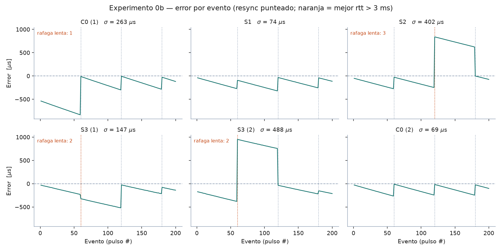
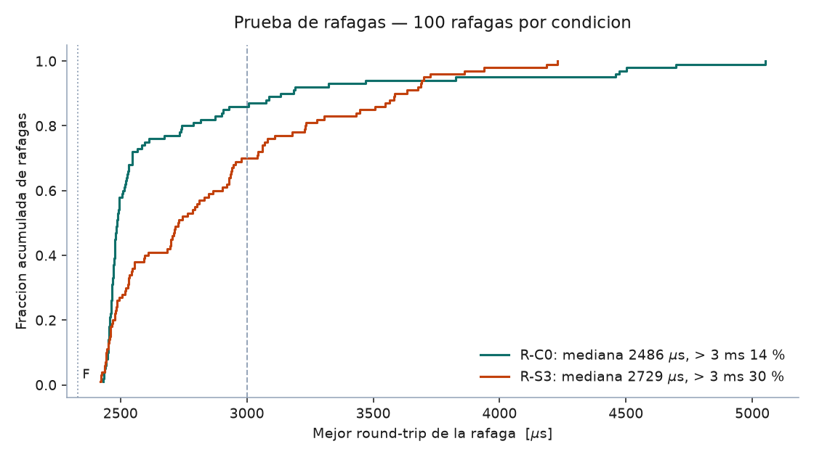
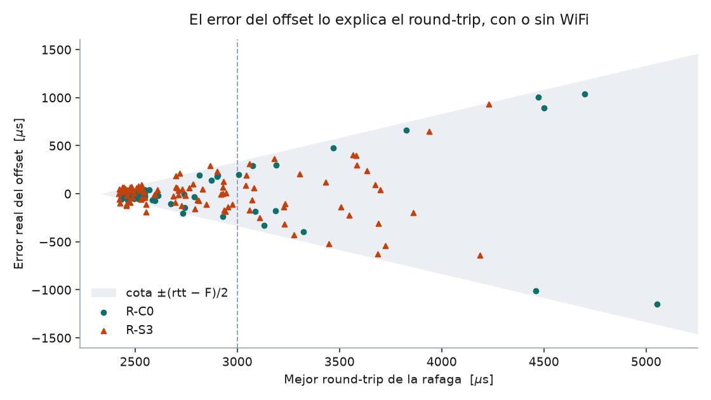
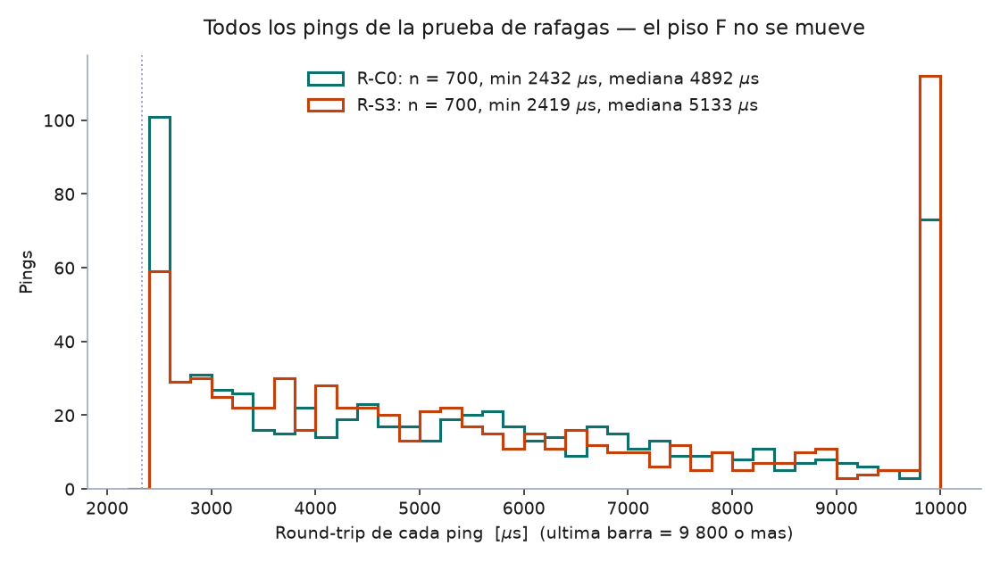

# Experimento 0b — Jitter con el hub sirviendo la página web

**Resultado:** σ(S3, peor caso) = **488 µs** · REQ-NF-02 pide ≤ 5 ms · **margen de 10×** (peor error individual 1 147 µs: 4.4×) · Estado: **HALLAZGO** — el hub puede servir la página, pero la carga del SoftAP degrada el resync de forma medible y el criterio 3.3 del plan no se cumple tal como se escribió

---

## 1. Objetivo

Cuantificar si el hub sigue midiendo igual de bien cuando, además de ESP-NOW, levanta un SoftAP, atiende teléfonos y empuja resultados por WebSocket. El Experimento 0 se hizo con el radio dedicado solo a ESP-NOW; en el sistema real el nodo de 40 yd comparte radio y CPU con el servidor web.

La afirmación bajo prueba: *el tráfico WiFi del SoftAP no degrada el resync ni el error de sincronización de forma relevante.*

Si se sostiene, el diseño de 4 nodos sin quinto ESP32 queda validado. Si no, hay argumento medido para aislar núcleos (Documento Maestro 13.2) o para un hub dedicado.

## 2. Principio metrológico

El mismo del Exp. 0: un pulso eléctrico compartido por cable llega a hub y nodo en nanosegundos. El valor verdadero de la diferencia de timestamps es **cero por construcción**; todo lo demás es error del sistema.

Para la prueba de ráfagas (sección 5.2) no hay pulso: la referencia es la **recta de deriva** ajustada a los 100 offsets de la corrida. La deriva entre cristales es lineal en escala de minutos (Exp. 0, sección 6.2); un ajuste de grado 2 y 3 dio el mismo residuo que la recta, así que el residuo es error real del offset y no curvatura de la deriva.

## 3. Montaje

| Señal | Hub | Nodo |
|---|---|---|
| Pulso (salida) | GPIO4 | — |
| Pulso (entrada) | GPIO16 | GPIO16 |
| Tierra | GND | GND (unida al hub) |

- Montaje del Exp. 0 sin cambios: GPIO4 → 330 Ω → GPIO16 de ambas placas. Sensor desconectado.
- Hub `A4:F0:0F:64:AC:68` (AP: `…:69`), nodo `B0:CB:D8:CA:11:F0`. Ambas por USB a la laptop.
- Radio en **canal 1** fijo en hub y nodo (trampa 1 del plan). En C0 el hub fuerza el canal 1 sin levantar el AP, así C0 solo difiere en el AP.
- Peer ESP-NOW del hub en la interfaz STA (trampa 2). El encabezado de cada corrida confirma canal 1 y ambas MAC.
- Servidor: ESP Async WebServer 3.12.1 + Async TCP 3.5.0, core 3.3.11, partición `huge_app`.
- Página de prueba: 306 KB de HTML con lastre aleatorio (semilla fija), **237 KB con gzip** (242 309 B; 242 583 B tras agregar el contador de descargas). El lastre aleatorio impide que gzip la reduzca a casi nada: lo que viaja por el aire es del orden de lo que pide el plan.
- Teléfonos: datos móviles apagados, conectados a `DASH-0b`.

| Escenario | Condición del hub | Teléfonos |
|---|---|---|
| C0 | SoftAP **apagado** (control) | ninguno |
| S1 | SoftAP encendido | ninguno |
| S2 | SoftAP + WebSocket | 1 escuchando |
| S3 | SoftAP + WebSocket + descarga de la página en ciclo | 1 en estrés + 2 escuchando |

## 4. Cambios de firmware bajo prueba

Hub y nodo parten de `prueba_0_A` / `prueba_0_B` **sin tocar** la ISR, `hacerResync()` ni la fórmula $\text{resultado} = t_{hub} - (t_{nodo} - \text{offset})$. Todo lo agregado va marcado `[0b]` en el código.

- **Hub:** `WIFI_AP_STA` + SoftAP en canal 1 (máx. 4 estaciones); servidor asíncrono con `/` (página gzip, `no-store` para que cada recarga baje todo) y `/ws`. El JSON de cada evento sale desde `loop()`, nunca desde la ISR ni el callback de ESP-NOW.
- **Nodo:** único cambio, `esp_wifi_set_channel(1)` y peer con canal explícito.
- **Registro:** CSV extendido `seq,resultado_us,offset_us,rtt_us,pongs_recibidos,clientes_ws,paginas` y, al final, el round-trip de cada uno de los 7 pings de cada ráfaga (líneas `R`).
- **Integridad del serial:** checksum XOR por línea (`*HH`, como NMEA) y tabla impresa dos veces. Agregado tras S1 intento 2 (sección 9).
- **Espera de arranque:** con SoftAP, el hub espera 60 s o el botón "Iniciar" de la página antes del primer resync, para que los teléfonos se reconecten tras el reinicio que provoca abrir el puerto.
- **`MODO_RAFAGAS`:** sin pulsos ni handshake; llama a la misma `hacerResync()` 100 veces, una cada 3 s, y manda un JSON por WebSocket cada 500 ms (la misma carga que la corrida normal).

La cota de error por ráfaga es la del Exp. 0:

$$\text{error}_{\max} = \frac{D - F}{2}, \qquad F = 2\,332\ \mu s$$

## 5. Procedimiento

### 5.1 Corridas de 200 pulsos (23-oct-2026)

Ejecutadas por el agente runner, en este orden: C0 → S1 → S2 → S3 → S3 (repetición con carga medida) → C0 (repetición). Para cada una:

1. Identificar los puertos por MAC.
2. Flashear hub → nodo → abrir el logger en el hub (`--fin "^# fin$"`), sin pausas.
3. En S2/S3, el usuario reconecta los teléfonos y toca "Iniciar" (o el hub arranca solo a los 60 s).
4. Primer resync, handshake, 200 pulsos cada 500 ms, resync cada 30 s (4 ráfagas por corrida, en seq 1, 60, 120, 180).
5. Impresión diferida, dos copias con checksum.

**Eventos registrados:** 200/200 en las 6 corridas válidas, **cero pérdidas**. Pongs: 7.00/7 en todas.

### 5.2 Prueba de ráfagas (23 y 24-oct-2026)

Agregada **después** de ver C0–S3: los dos C0 del día dieron 263 y 69 µs con el mismo montaje, así que con 4 ráfagas por corrida la σ depende de la suerte de una sola y no puede decir si el SoftAP degrada el resync.

1. R-C0: hub con `-DSOFTAP_ACTIVO=0 -DMODO_RAFAGAS=1`, sin teléfonos.
2. R-S3: hub con `-DMODO_RAFAGAS=1` (espera de arranque 180 s), la carga completa de S3.
3. 100 ráfagas por condición, una cada 3 s (297 s de corrida).

**Ráfagas registradas:** 100/100 en cada condición, 700/700 pings respondidos en cada una.

## 6. Resultados

Las seis corridas muestran el diente de sierra del Exp. 0. Lo que cambia la σ no es el escenario, sino si alguna de las 4 ráfagas salió lenta (línea naranja): ese bloque arranca desplazado cientos de µs y arrastra la σ de toda la corrida.

### 6.1 Predicción contra resultado

| | Predicción (escrita el 23-oct-2026) | Medido |
|---|---|---|
| Corridas C0–S3 | **Sin predicción**: el usuario no la hizo; rigen los criterios del plan (3.3) | — |
| Criterio 3.3: σ(S3) ≤ 1.5 × σ(C0 del día) | ≤ 395 µs (C0 1) o ≤ 104 µs (C0 2) | **488 µs → no se cumple** contra ninguno de los dos C0 |
| Criterio 3.3: cero eventos perdidos | 0 | **0** (200/200 en todas) |
| REQ-NF-02: σ ≤ 5 ms | ≤ 5 000 µs | **≤ 488 µs → cumple con 10×** |
| Señal temprana: mediana del rtt elegido ≫ 2.5 ms o pongs < 7 | — | Mediana 2 444–2 644 µs; pongs 7.00/7. Sin señal en las corridas de 200 pulsos |
| Prueba de ráfagas | **Sin predicción**, registrado antes de correrla | Ráfagas lentas 14 % → 30 % con carga (6.3) |

El criterio 3.3 falla, pero no por el mecanismo que buscaba: la σ de una corrida de 4 ráfagas mide sobre todo la suerte de una ráfaga. C0, que no tiene SoftAP, dio 263 µs en una corrida y 69 µs en otra.

### 6.2 Tabla por escenario (corridas de 200 pulsos)

| Corrida | Eventos | σ (µs) | Media (µs) | rtt elegido, mediana (µs) | Clientes WS | Descargas/s | Líneas corruptas |
|---|---|---|---|---|---|---|---|
| C0 (1) | 200/200 | 263 | −302 | 2 515 | 0 | — | 0 |
| S1 | 200/200 | 74 | −160 | 2 455 | 0 | — | 2 (recuperadas) |
| S2 | 200/200 | 402 | +125 | 2 560 | 1 | — | 0 |
| S3 (1) | 200/200 | 147 | −214 | 2 459 | 2–3 | no medida | 2 (recuperadas) |
| S3 (2) | 200/200 | **488** | +116 | 2 644 | 2–3 | **0.94** | 6 (recuperadas) |
| C0 (2) | 200/200 | 69 | −129 | 2 444 | 0 | 0 | 0 |

S3 (1) no tiene la carga verificada: el contador de descargas se agregó después (sección 9). La corrida de referencia de S3 es la (2).

**Descomposición por ráfaga.** Error al inicio de cada bloque contra el mejor rtt de la ráfaga que lo abrió:

| Corrida | Ráfaga lenta | Mejor rtt | Cota ±(rtt − F)/2 | Error al inicio del bloque | Resto de los bloques arrancan en |
|---|---|---|---|---|---|
| C0 (1) | 1 | 3 634 µs | ±651 µs | −539 µs | −7 a −27 µs |
| S2 | 3 | 4 232 µs | ±950 µs | +840 µs | −1 a −52 µs |
| S3 (1) | 2 | 3 131 µs | ±400 µs | −324 µs | −27 a −79 µs |
| S3 (2) | 2 | 4 882 µs | ±1 275 µs | +951 µs | −34 a −174 µs |
| S1, C0 (2) | ninguna | ≤ 2 536 µs | ≤ ±102 µs | — | −11 a −93 µs |

En las 6 corridas, el bloque que se sale está abierto por una ráfaga con mejor rtt > 3 ms, y su error cae dentro de la cota. Una de las cuatro ráfagas lentas ocurrió **sin** SoftAP (C0 1).

### 6.3 Prueba de ráfagas

Con la carga de S3 la curva se corre a la derecha: el 30 % de las ráfagas tiene su mejor ping por encima de 3 ms, contra 14 % sin SoftAP.

| | R-C0 | R-S3 | Prueba |
|---|---|---|---|
| Ráfagas válidas | 100 | 100 | |
| Descargas de la página | 0 | 290 en 297 s (**0.98/s**, 67 MB gz) | |
| Clientes WebSocket (mediana) | 0 | 3 | |
| Mejor rtt, mediana | 2 486 µs | **2 729 µs** | Mann-Whitney p = 7 × 10⁻⁵ |
| Mejor rtt, p90 / máximo | 3 186 / 5 052 µs | 3 635 / 4 229 µs | |
| **Ráfagas lentas (> 3 ms)** | **14/100** | **30/100** | Fisher (dos colas) p = 0.010 |
| Cota de error, mediana | ±77 µs | ±198 µs | |
| Deriva (pendiente de la recta) | 7.9 µs/s | 8.9 µs/s | |
| **Error real del offset, σ** | **260 µs** | **217 µs** | |
| Error real del offset, máximo | 1 147 µs | 935 µs | |
| Error σ en ráfagas ≤ 3 ms | 58 µs (n = 86) | 93 µs (n = 70) | |
| Error σ en ráfagas > 3 ms | 669 µs (n = 14) | 369 µs (n = 30) | |
| Error dentro de la cota (+100 µs de incertidumbre de la recta) | 100/100 | 100/100 | |

Los 200 puntos caen dentro de la cota ±(rtt − F)/2, con y sin WiFi. Por debajo de 3 ms el error es de decenas de µs; por encima se abre en abanico hasta ±1.1 ms. El WiFi no cambia la relación; cambia cuántas ráfagas caen del lado malo.

Lectura de la σ total: R-S3 tiene más ráfagas lentas pero menos extremas (máximo 4 229 contra 5 052 µs), por eso su σ total (217 µs) no supera a la de R-C0 (260 µs). La σ total de 100 ráfagas la deciden las 2–3 peores; la frecuencia de ráfagas lentas es la métrica que responde la pregunta del experimento.

El piso no sube: el ping más rápido fue 2 432 µs (C0) y 2 419 µs (S3). Lo que cambia es la cola: los pings ≤ 2.6 ms bajan de 101 a 59 de 700, y los ≥ 9.8 ms suben de 73 a 112 (mediana 4 892 → 5 133 µs, Mann-Whitney p = 0.012). Aun sin SoftAP, el 77 % de los pings individuales pasa de 3 ms: el filtro de latencia mínima sigue siendo indispensable.

El mínimo observado (2 419–2 530 µs en todas las corridas del día) queda ~90 µs por encima de F = 2 332 µs del Exp. 0. Se conserva F = 2 332 µs en las cotas porque es el valor medido; con un F mayor las cotas serían más estrechas, no más anchas.

## 7. Contexto en el presupuesto de error

| Fuente | Estimado (v2.0) | Exp. 0 | Exp. 0b (con SoftAP y carga) |
|---|---|---|---|
| Geometría corporal | ±20–50 ms | — | — (dominante, irreducible) |
| Cuantización del sensor | ±10 ms | — | — (pendiente, Exp. 1) |
| **Sincronización entre nodos** | **±1–2 ms** | **±0.17 ms** | **±0.49 ms** (peor corrida); error del offset σ 0.22 ms, máximo 0.94 ms (R-S3) |
| Latencia del enlace de radio | 0 ms | confirmado 0 | confirmado 0 (0 pérdidas, 1 400/1 400 pings) |

Con carga, la sincronización sigue por debajo de lo presupuestado y dos órdenes de magnitud por debajo del error dominante. Firmeza: **medido**, pero la σ de una corrida de 200 pulsos tiene baja repetibilidad (69–263 µs en el mismo control); la cifra robusta es el error del offset sobre 100 ráfagas.

## 8. Conclusiones

1. **El hub puede servir la página sin poner en riesgo REQ-NF-02.** Peor σ 488 µs (margen 10×), peor error individual 1 147 µs (4.4×), 0 eventos perdidos en 1 200 pulsos y 0 pongs perdidos en 1 400 pings de la prueba de ráfagas. Se sostiene la arquitectura de 4 dispositivos sin quinto ESP32 y ADR-003.

2. **La carga del SoftAP sí degrada el resync, y es medible.** Ráfagas lentas 14 % → 30 % (p = 0.010), mejor rtt mediano 2 486 → 2 729 µs (p < 0.001). El piso F no se mueve; crece la cola. La afirmación bajo prueba ("no degrada de forma relevante") queda **refutada en el resync** y **sostenida en el resultado final**.

3. **El criterio 3.3 del plan no mide lo que pretendía.** Con 4 ráfagas por corrida, la σ es la suerte de una ráfaga: el mismo control dio 263 y 69 µs. Para comparar escenarios hace falta la frecuencia de ráfagas lentas sobre ~100 ráfagas, no la σ de una corrida.

4. **El mecanismo dominante es la ráfaga lenta, con o sin WiFi.** En las ráfagas ≤ 3 ms el error del offset es σ 58 µs (C0) y 93 µs (S3); en las > 3 ms, 669 y 369 µs. Todo el error cae dentro de la cota (rtt − F)/2 (200/200). **Candidato a ADR:** descartar y repetir una ráfaga cuyo mejor rtt pase de ~3 ms. Con las tasas medidas, la probabilidad de dos ráfagas lentas seguidas sería ~2 % (C0) y ~9 % (S3), suponiendo independencia (estimado, no medido).

5. **Energía: hallazgo nuevo, no buscado.** Con la carga de S3, el hub entró en un bucle de 422 reinicios por brownout alimentado por USB de la laptop conectada a la corriente; en la corrida válida hubo 1 brownout al abrir el puerto. Sube la prioridad de medir el riel de 3.3 V (DM 20) y del margen del regulador en la PCB. Con batería 18650 el comportamiento puede ser otro: **pendiente**.

6. **El serial se corrompe solo con el SoftAP activo** (2–6 líneas por corrida con AP, 0 en los dos C0). No afecta la medición; queda resuelto con checksum y tabla doble.

7. **El aislamiento de núcleos (13.2) no es necesario para cumplir REQ-NF-02**, pero sería la vía si se quisiera recuperar la tasa de ráfagas lentas de C0. Antes conviene probar el reintento de ráfagas (conclusión 4), que es más barato y ataca el mecanismo con o sin WiFi.

## 9. Incidencias resueltas durante la ejecución

| Síntoma | Causa raíz | Solución |
|---|---|---|
| S1 intento 1: el logger cortó a los 61 s | `--fin "^# fin"` también coincide con `# fin de espera` | Marcador exacto `^# fin$` |
| S1 intento 2: seq 55–56 ilegibles y seq 58 con rtt 981 en vez de 2 981 | Bytes corruptos en el serial con el SoftAP activo; una línea dañada pasó como válida | Checksum XOR por línea y tabla impresa dos veces; `resumen_corrida.py` descarta líneas sin checksum válido. S1 se repitió |
| S3 (1): `clientes_ws` se quedó en 3 aunque el teléfono hizo ~70 recargas | Contar clientes WebSocket no mide las recargas; además `location.reload()` deja la página de error si una descarga falla y el estrés se detenía | Contador de descargas de `/` en el hub (columna `paginas`); el modo estrés descarga con `fetch` en ciclo y reintenta. S3 se repitió con carga medida (0.94/s) |
| Una línea sin `*` en un archivo con checksum se aceptaba como formato viejo | Una línea que pierde su checksum por corrupción parece del Exp. 0 | Si el archivo usa checksum, toda línea sin `*` se descarta |
| R-S3 intento 1: 422 reinicios seguidos por `Brownout detector was triggered` | Pico de corriente del radio con 3 estaciones y descargas; el S3 de 200 pulsos una hora antes no lo tuvo, así que cambió algo físico (puerto, cable o fuente) | Se repitió el 24-oct; 1 solo brownout al abrir el puerto, sin bucle. Causa física sin aislar: **pendiente** |

**Hipótesis descartada:** "la σ alta de S2 y S3 (2) la causa el WiFi". C0 (1), sin SoftAP, tuvo el mismo mecanismo (ráfaga 1 con mejor rtt 3 634 µs, bloque desplazado −539 µs). La prueba de ráfagas confirma que el WiFi cambia la frecuencia del mecanismo, no lo crea.

## 10. Archivos

| Archivo | Contenido |
|---|---|
| `prueba_0b_hub/prueba_0b_hub.ino` | Hub del 0b (C0 con `-DSOFTAP_ACTIVO=0`; ráfagas con `-DMODO_RAFAGAS=1`) |
| `prueba_0b_hub/pagina_gz.h` | Página de prueba comprimida (generada) |
| `prueba_0b_nodo/prueba_0b_nodo.ino` | Nodo del 0b (canal fijo) |
| `pagina_prueba/pagina_prueba.html` | Plantilla de la página de prueba (escucha y modo estrés) |
| `generar_pagina.py` | Inserta el lastre aleatorio, comprime y escribe `pagina_gz.h` |
| `procedimiento.md` | Cómo se corre cada escenario y la prueba de ráfagas |
| `analizar_rafagas.py` | Métricas de la prueba de ráfagas |
| `graficar_exp0b.py` | Gráficas 01–04 y las tablas de este reporte |
| `exp0b_C0_2026-10-23.csv` | C0 (1): σ 263 µs, sin checksum (anterior a su introducción) |
| `exp0b_C0_2026-10-23_2.csv` | C0 (2): σ 69 µs |
| `exp0b_S1_2026-10-23.csv` | S1: σ 74 µs |
| `exp0b_S1_2026-10-23_intento1_fin_prematuro.csv` | S1 intento 1: corte a los 61 s por el marcador de fin |
| `exp0b_S1_2026-10-23_intento2_sin_checksum.csv` | S1 intento 2: corrida completa con líneas corruptas, sin checksum |
| `exp0b_S2_2026-10-23.csv` | S2: σ 402 µs |
| `exp0b_S3_2026-10-23.csv` | S3 (1): σ 147 µs, carga no verificada |
| `exp0b_S3_2026-10-23_2.csv` | S3 (2): σ 488 µs, 0.94 descargas/s |
| `exp0b_rafagas_C0_2026-10-23.csv` | Prueba de ráfagas sin SoftAP |
| `exp0b_rafagas_S3_2026-10-23.csv` | Prueba de ráfagas con carga de S3 (corrida el 24-oct; el nombre conserva la fecha del intento 1) |
| `exp0b_rafagas_S3_2026-10-23_intento1_brownout.csv` | Intento 1: bucle de 422 brownouts, sin datos |
| `01_series_escenarios.png` | Error por evento en las 6 corridas |
| `02_rtt_rafagas.png` | Distribución acumulada del mejor rtt por ráfaga |
| `03_error_vs_rtt.png` | Error real del offset contra mejor rtt, con la cota |
| `04_pings_todos.png` | Round-trip de todos los pings de la prueba de ráfagas |
