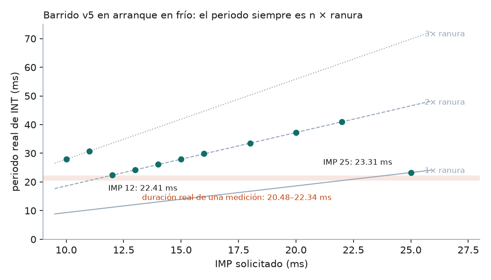
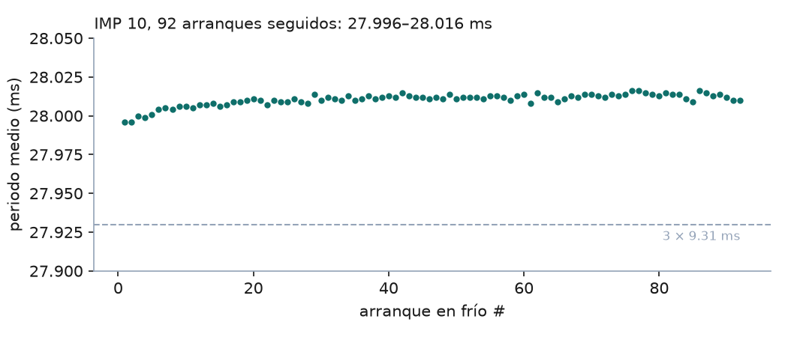

# Caracterización del VL53L1X — cadencia de INT y elección del IMP

**Resultado:** a IMP = 25 ms el periodo real es **23.31 ms (1 ranura) en arranque en frío** → cuantización σ = **6.73 ms** · presupuesto de la sección 6: ±10 ms · **margen de 1.5×** · Estado: **APROBADO en régimen válido**; régimen sin retorno medido con fondo de vidrio (sección 11), **cielo abierto pendiente (S2b)**

---

## 1. Objetivo

Medir la cadencia real con la que el VL53L1X avisa por INT y elegir el inter-measurement period (IMP) que la hace más corta. La cadencia fija la ranura de medición, y la ranura fija el error de cuantización, que es la contribución del sensor al presupuesto de error (sección 6).

La afirmación bajo prueba: *con IMP = 25 ms el chip entrega una medición cada ranura (23.28 ms) también en arranque en frío, que es como arranca cada nodo en campo.*

Este reporte junta tres corridas: el smoke test y el barrido v3 (11-oct-2026) y el barrido v5 en arranque en frío (23-oct-2026).

## 2. Principio metrológico

El periodo entre interrupciones se mide con `esp_timer_get_time()` capturado como primera instrucción de la ISR, la misma técnica del Experimento 0, donde el jitter puro de captura resultó de **1.3 µs**. Eso está cuatro órdenes de magnitud por debajo de la ranura (~23 ms) y dos por debajo del jitter de cadencia observado (≥ 48 µs). Todo lo que se mide como variación del periodo es del chip, no de la captura.

Valor esperado: si el modelo de la sección 9.2 es correcto, el periodo es un **múltiplo entero** de la ranura, con ranura = IMP × 0.931.

## 3. Montaje

| Señal | Módulo TOF400C-VL53L1X | ESP32-WROOM-32U (hub) |
|---|---|---|
| Alimentación | VIN | 3V3 |
| Tierra | GND | GND |
| I2C datos | SDA | GPIO21 |
| I2C reloj | SCL | GPIO22 |
| Interrupción | GPIO1 (INT) | GPIO16 |
| Reset por hardware | XSHUT | GPIO17 (solo v5) |

- Protoboard con jumpers; I2C a **100 kHz** (400 kHz se caía, provisional, sección 12.2).
- Modo corto, timing budget pedido 20 000 µs (el chip reporta **20 024 µs**).
- Blanco: cartulina **fija** a 1104–1105 mm (v5). Las corridas del 11-oct se hicieron sobre el mismo montaje sin XSHUT.
- Placa identificada por MAC (`a4:f0:0f:64:ac:68`, hub) en COM7.

## 4. Modelo de cadencia

El chip divide el tiempo en ranuras de ancho fijo:

$$\text{ranura} = \text{IMP} \times 0.931$$

El 0.931 es un error de escala del oscilador interno, medido en el smoke test con tres IMP independientes (25, 33 y 40 ms → 0.9313, 0.9309, 0.9307).

Una medición dura un tiempo `T`. Si no cabe en una ranura, el chip espera a la siguiente frontera, así que el periodo es

$$\text{periodo} = n \times \text{ranura}, \qquad n = \left\lceil \frac{T}{\text{ranura}} \right\rceil$$

Y la cuantización por sensor, suponiendo ventanas uniformes:

$$\sigma_q = \frac{\text{periodo}}{\sqrt{12}}$$

## 5. Procedimiento

**Smoke test (11-oct-2026).** Escaneo I2C, `init()` (valida el Model ID 0xEACC: es VL53L1X, no VL53L0X), modo corto, budget 20 ms, IMP 20 ms, captura continua con ISR. 648 muestras separadas después por régimen (con blanco y sin retorno).

**Barrido v3 (11-oct-2026).** Varias configuraciones de IMP en un solo arranque, con `stopContinuous → configurar → startContinuous` entre una y otra. 8 muestras de descarte y 50 de medición por configuración.

**Barrido v5 (23-oct-2026).**

1. Una sola configuración por arranque del ESP32. Entre una y otra, `ESP.restart()` y reset del sensor por XSHUT: cada medición parte del estado de un nodo recién encendido.
2. IMP barrido: 10, 11, 12, 13, 14, 15, 16, 18, 20, 22 y 25 ms.
3. Por configuración, 10 muestras de descarte y 120 de medición. Solo entran a la estadística los intervalos entre dos muestras válidas.
4. Los resultados se guardan en memoria RTC (`RTC_NOINIT_ATTR`) y al final se imprime la tabla resumen.
5. Captura con `tools/logger_serial.py` a 921 600 baud, desde el arranque hasta el marcador `Barrido terminado`: **87 líneas en 70 s**.

**Control de la corrida v5:** 11/11 configuraciones, 1320/1320 muestras válidas, 0/1309 intervalos anómalos.

## 6. Resultados

Las 11 configuraciones caen sobre las rectas de 1, 2 o 3 ranuras. La desviación máxima del cociente periodo/ranura respecto al entero es **0.009**. El modelo de la sección 4 se confirma.

### 6.1 Predicción contra resultado

| | Predicción (escrita el 23-oct-2026, en `docs/ESTADO.md`) | Medido |
|---|---|---|
| Ranuras a IMP 25 en frío | Sin predicción numérica del usuario. La evidencia previa apuntaba a **2 ranuras** (smoke test, v4 y config 1 del v3, todas en frío) | **1.001 ranuras (23.31 ms)** |

Esto es un **hallazgo**. La hipótesis "en arranque en frío todo da 2 ranuras" queda refutada. Las corridas en frío que dieron 2 ranuras se explican sin ella: el smoke test usaba IMP 20 (ranura 18.62 ms < T), que da 2 ranuras por el modelo. El v4 no está en el repo y no se puede revisar (ver sección 9).

### 6.2 Barrido v5 completo

| IMP (ms) | Ranura (ms) | Periodo (ms) | Ranuras | Jitter (µs) | Anómalos | Válidas |
|---|---|---|---|---|---|---|
| 10 | 9.31 | 28.011 | 3.009 | 265.8 | 0/119 | 120/120 |
| 11 | 10.24 | 30.804 | 3.008 | 175.9 | 0/119 | 120/120 |
| 12 | 11.17 | **22.405** | 2.006 | 64.7 | 0/119 | 120/120 |
| 13 | 12.10 | 24.265 | 2.005 | 105.0 | 0/119 | 120/120 |
| 14 | 13.03 | 26.128 | 2.005 | 185.8 | 0/119 | 120/120 |
| 15 | 13.97 | 27.991 | 2.004 | 241.7 | 0/119 | 120/120 |
| 16 | 14.90 | 29.849 | 2.004 | 266.1 | 0/119 | 120/120 |
| 18 | 16.76 | 33.568 | 2.003 | 71.3 | 0/119 | 120/120 |
| 20 | 18.62 | 37.288 | 2.003 | 56.9 | 0/119 | 120/120 |
| 22 | 20.48 | 41.011 | 2.002 | 48.4 | 0/119 | 120/120 |
| 25 | 23.28 | **23.308** | 1.001 | 235.2 | 0/119 | 120/120 |

### 6.3 Duración real de una medición

El barrido acota `T` sin medirlo directamente:

- IMP 22 da 2 ranuras → una medición **no cabe** en 20.48 ms.
- IMP 12 da 2 ranuras de 11.17 ms → una medición **sí cabe** en 22.34 ms.

$$20.48 \text{ ms} < T \le 22.34 \text{ ms}$$

`T` es mayor que el budget reportado (20.02 ms) en al menos 0.46 ms: el chip gasta tiempo fuera de la integración. Consecuencia: el margen a IMP 25 es **0.94–2.80 ms**, no los 3.3 ms de la sección 9.2, que suponían `T` = budget. Firmeza: **firme** como cota (11 configuraciones consistentes); el valor exacto de `T` no está medido.

### 6.4 Repetibilidad entre arranques

El primer intento del v5 se quedó en un bucle en la config 1 (sección 9), y eso dio sin querer **92 arranques en frío seguidos a IMP 10**: periodo medio entre **27.996 y 28.016 ms**, con desviación estándar entre arranques de **4.0 µs**. El chip llega a la misma cadencia en cada arranque. Se ve una subida lenta de ~0.015 ms en los primeros ~20 arranques. Es compatible con calentamiento, pero no está verificado.

### 6.5 Jitter de cadencia

| Fuente | Condición | Jitter (1σ) |
|---|---|---|
| Documento Maestro 9.2 (11-oct) | IMP 25, 51 muestras | 10.6 µs |
| Smoke test (11-oct) | IMP 20, régimen válido, 404 intervalos | 81 µs |
| Smoke test (11-oct) | IMP 20, régimen inválido, 241 intervalos | 266 µs |
| v5 (23-oct) | 11 configuraciones, régimen válido | 48–266 µs (235 µs a IMP 25) |
| v5 intento 1 (23-oct) | IMP 10, misma configuración, 92 arranques | 44–315 µs |

El jitter **varía de una corrida a otra en la misma configuración** (44 a 315 µs a IMP 10). El valor de 10.6 µs no se reproduce y debe dejar de considerarse firme. Aun en el peor caso (315 µs), es el **1.4 %** de la ranura y queda 20× por debajo de la cuantización (6.73 ms). No cambia ninguna decisión.

### 6.6 Hallazgos del smoke test (11-oct-2026, sección 9.2–9.4 del Documento Maestro)

No hay datos crudos de estas corridas en el repo; las cifras vienen del Documento Maestro v2.1.

| Hallazgo | Valor | Firmeza (DM 0.2) |
|---|---|---|
| Factor de escala de la ranura | 0.931 (3 IMP independientes) | Firme |
| Dos regímenes a IMP 20 | 18.6 ms sin blanco, 37.24 ms con blanco | Firme |
| Intervalos anómalos, régimen inválido, IMP 20 | 33/241 (13.7 %), cada uno ~9.3 ms más largo | Firme a IMP 20; sin medir a IMP 25 |
| Intervalos anómalos, régimen válido, IMP 20 | 0/404 | Firme |
| Alcance útil en modo corto | 1.38 m (corte entre 1372 y 1395 mm, 4 transiciones) | Firme |
| Pin INT | Activo en bajo y latcheado hasta `read()` | Verificado en banco |
| Ancho del pulso bajo de INT | ~3.5 ms a 100 kHz (15 % de la ranura) | Medido |

## 7. Contexto en el presupuesto de error

| Fuente | Estimado (v2.0) | v2.1 (11-oct) | Este reporte |
|---|---|---|---|
| Geometría corporal | ±20–50 ms | — | — (dominante, irreducible) |
| **Cuantización del sensor** | ±10 ms | ±6.72 ms (piso), ~7.5 ms esperado | **±6.73 ms confirmado en frío**, régimen válido |
| Sincronización entre nodos | ±1–2 ms | ±0.17 ms (Exp. 0) | — |
| Jitter de cadencia del chip | — | 10.6 µs | 48–315 µs (despreciable) |

La cuantización sigue dentro del presupuesto de ±10 ms, con margen de 1.5×. El valor esperado de ~7.5 ms depende de la tasa de intervalos anómalos en régimen inválido a IMP 25, que no se ha medido.

## 8. Conclusiones

1. **El ADR-011 (IMP = 25 ms) se sostiene en arranque en frío.** Periodo de 23.31 ms (1.001 ranuras), 120/120 válidas, 0 anómalos. Antes solo se tenía con el estado heredado del v3.
2. **El modelo periodo = n × ranura queda confirmado en 11 configuraciones** (desviación máxima 0.009 ranuras). La cadencia es predecible a partir del IMP, sin sorpresas.
3. **El margen a IMP 25 es de 0.94–2.80 ms, no de 3.3 ms.** Una medición dura entre 20.48 y 22.34 ms, más que el budget de 20.02 ms. Eso hace más importante la corrida larga en régimen inválido (sección 19): si el margen se agota, el periodo salta a 46.6 ms.
4. **IMP 12 es la única alternativa más rápida**: 22.41 ms (−0.9 ms, cuantización 6.47 ms, −4 %), con un margen de 0–1.86 ms. La ganancia no mueve el presupuesto. Se recomienda **mantener IMP 25** (preferencia respaldada por el margen; decisión abierta en `docs/ESTADO.md`).
5. **El jitter de cadencia de 10.6 µs no es reproducible**: varía entre 44 y 315 µs según la corrida. Es irrelevante frente a la cuantización, pero su firmeza en el Documento Maestro debe bajar.
6. **Pendiente para cerrar el sensor:** el régimen inválido (apuntando al cielo) a IMP 25. Ninguna corrida lo ha medido en esa configuración, y es la condición en que las puertas de split y meta pasan casi todo el tiempo.

## 9. Incidencias resueltas durante la ejecución

| Síntoma | Causa raíz | Solución |
|---|---|---|
| "Sin interrupciones" en el barrido v2 | `attachInterrupt(FALLING)` antes de `startContinuous()` con INT ya latcheado en bajo: nunca hubo flanco | v3: ISR después de `startContinuous()`, limpiando el pin antes; rescate por nivel si pasan > 2 periodos |
| "Bus no responde" en v2 | `init()` en cada configuración: el reset por software deja el chip en mal estado | `init()` una sola vez; reconfigurar con `stopContinuous → … → startContinuous` |
| Bus I2C caído | 400 kHz en protoboard con jumpers largos | 100 kHz (provisional, re-medir en PCB) |
| v3 y v4 se contradicen en la misma configuración (1 contra 2 ranuras) | Hipótesis: estado heredado entre configuraciones | v5: una configuración por arranque. Resultado: en frío, IMP 25 da 1 ranura. **La contradicción con el v4 queda sin explicar**: su sketch y sus datos no están en el repo |
| El v5 no compilaba | `#define MAGIC 0xDA5HC001`: la H no es hexadecimal | `0xDA5AC001` (valor arbitrario) |
| El v5 repetía la config 1 indefinidamente (97 arranques en 10 min) | `RTC_DATA_ATTR` se reinicializa en todo reinicio que no sea despertar de deep sleep | `RTC_NOINIT_ATTR`; el `MAGIC` ya cubría la basura del encendido |

Hipótesis descartada con datos: **"en arranque en frío todo da 2 ranuras"**. IMP 25 en frío dio 1.001 ranuras.

## 10. Archivos

| Archivo | Contenido |
|---|---|
| `smoke_test_vl53l1x/smoke_test_vl53l1x.ino` | Smoke test: escaneo I2C, Model ID, captura continua con ISR |
| `barrido_config_v3/barrido_config_v3.ino` | Barrido con varias configuraciones por arranque (estado heredado) |
| `barrido_config_v5/barrido_config_v5.ino` | Barrido en arranque en frío, una configuración por arranque (vigente) |
| `barrido_v5_frio_2026-10-23.txt` | Salida serial cruda del v5: 11 configuraciones y tabla resumen |
| `barrido_v5_intento1_bucle_2026-10-23.txt` | Intento 1 del v5 (bucle en la config 1): 92 mediciones completas a IMP 10 |
| `graficar_sensor.py` | Genera las gráficas 01–02 e imprime los números derivados de este reporte |
| `01_periodo_vs_imp.png` | Periodo real contra IMP, con las rectas n × ranura y la banda de T |
| `02_repetibilidad_imp10.png` | Periodo medio en 92 arranques en frío a IMP 10 |
| `corrida_cielo/corrida_cielo.ino` | Corrida larga: 5000 interrupciones en arranque en frío, LED de cruce en GPIO18 (sección 11) |
| `analizar_cielo.py` | Separa intervalos por régimen, cuenta anómalos y saltos, verifica el fondo con la columna `cue` |
| `corrida_cielo_IMP25_2026-10-24.txt` | Intento 1: no válido (sin LED visible, cruces irregulares) |
| `corrida_cielo_IMP25_2026-10-24_2.txt` | Intento 2: cortado a mano (LED sin GND), sin muestras |
| `corrida_cielo_IMP25_2026-10-24_3.txt` | Intento 3: la corrida válida con fondo de vidrio |

No están en el repo: los datos crudos del smoke test y del v3, y el sketch y los datos del v4.

## 11. Corrida larga en régimen sin retorno (24-oct-2026, fondo de vidrio)

**Resultado:** a IMP 25, **0 saltos a 46.6 ms en 1 054 intervalos con blanco** y **3.3 % de intervalos anómalos sin blanco**: anómalos de fase (±9.5 ms), no ranuras perdidas. El ADR-011 se sostiene. Falta repetirla apuntando al **cielo abierto** (S2b): esta se hizo contra un vidrio a ~2 m.

### 11.1 Objetivo

Medir la condición en la que las puertas de split y meta pasan casi todo el tiempo: sin nada en el haz (régimen inválido). Dos preguntas abiertas (Maestro v2.2, 9.2 y 19):
1. ¿Se agota el margen de 0.94–2.8 ms y el periodo salta a 2 ranuras (46.6 ms)?
2. ¿Qué tasa de intervalos anómalos hay sin blanco a IMP 25? A IMP 20 fue 13.7 %, todos +9.3 ms.

### 11.2 Montaje y procedimiento

- Sensor en la placa hub (COM7), cableado del v5 (XSHUT a GPIO17), modo corto, budget 20 ms, IMP 25, arranque en frío.
- **Fondo:** vidrio a ~2 m, más allá del alcance del modo corto (1.38 m). El sensor lo reporta con status 4 (fuera de rango).
- **Cruces guiados:** un LED externo en GPIO18 se enciende 1 s cada 4 s. Con el LED encendido el usuario cruza la mano o una cartulina a 0.3–1 m; apagado, deja el haz libre. El estado del LED se guarda en cada muestra (columna `cue`).
- 5 000 interrupciones capturadas (~116 s); impresión diferida al final con checksum.
- Análisis: `analizar_cielo.py`. Separa cada intervalo por el status de sus dos extremos (válido, inválido o transición) y lo clasifica en 1 ranura, 2 ranuras o anómalo (tolerancia ±0.15 ranuras).

### 11.3 Predicción contra resultado

| | Predicción (escrita el 24-oct-2026) | Medido |
|---|---|---|
| Corrida larga | **Sin predicción**: el usuario no la hizo, registrado antes de correr | — |
| Saltos a 2 ranuras con blanco | — | **0 / 1 054** |
| Anómalos sin blanco | Referencia: 13.7 % a IMP 20 | **3.3 % (127 / 3 878)** |

### 11.4 Resultados (intento 3)

| Régimen | Intervalos | 1 ranura | 2 ranuras | Anómalos | Mediana | Jitter de los normales |
|---|---|---|---|---|---|---|
| Válido (blanco en el haz) | 1 054 | 1 054 | 0 | 0 (0.0 %) | 23.293 ms | 133 µs |
| Inválido (sin blanco) | 3 878 | 3 751 | 0 | 127 (3.3 %) | 23.282 ms | 38 µs |
| Transición | 62 | 33 | 0 | 29 (46.8 %) | 23.305 ms | 70 µs |

- **El fondo no da retorno.** Con el LED apagado desde hace más de 1 s, solo 1 de 2 473 muestras salió válida (0.04 %). Las válidas del primer segundo tras apagarse el LED son la mano saliendo, a ~40 cm: 665 de 666 caen en ese segundo.
- **31 cruces** en 116 s. Con el LED encendido solo el 34 % de las muestras fue válido: es la reacción humana (la mano llega tarde). No afecta la medición; solo dice que los cruces duran menos que la ventana del LED.
- **Los anómalos son de fase, no ranuras perdidas.** Hay exactamente 78 intervalos cortos (−9.5 ms) y 78 largos (+9.5 ms), y casi nunca vienen seguidos (2 pares). Sin blanco, el INT se adelanta ~9.5 ms y se queda adelantado; al entrar un blanco regresa a su fase (en las transiciones, la mediana del exceso es +9.5 ms). El periodo medio de toda la corrida es 23.284 ms: no se pierde ninguna ranura.
- Hipótesis, **sin verificar**: sin retorno la medición aborta antes de completar el budget (la 9.2 ya lo describe a IMP 20) y el INT sale antes.

### 11.5 Lo que esto cambia

1. **ADR-011 (IMP 25) se sostiene:** el margen no se agotó en 1 054 intervalos con blanco.
2. **El modelo de "ventanas de ancho variable" de la 9.2 hay que revisarlo.** Se escribió para anómalos +9.3 ms al 13.7 % (σ de cuantización 7.54 ms; predicción del Exp. 1 de 10.7 ms). A IMP 25 los anómalos son 3.3 % y simétricos.
3. **El instante del cruce es justo donde aparecen** (47 % de las transiciones lleva el +9.5 ms). El Experimento 1 medirá si eso agrega error a la detección.
4. Los cambios al Maestro esperan a S2b (decisión del usuario): están en `docs/ESTADO.md`, "Cambios pendientes para el Documento Maestro v2.3".

### 11.6 Incidencias

| Síntoma | Causa raíz | Solución |
|---|---|---|
| Intento 1: el usuario no vio el LED y cruzó pocas veces, sin patrón | El LED integrado (GPIO2) no se ve bien y no indicaba cuándo cruzar | LED externo en GPIO18 con ciclo de 1 s encendido cada 4 s, y columna `cue`. El intento 1 se conserva y se marca como no válido: con 12.7 % de válidas no se distinguen cruces de lecturas de la cortina |
| Intento 2: el LED externo no encendía | Faltaba el GND del LED | Cortado a mano; se conserva el archivo parcial, sin muestras |
| Intento 3: el logger cortó a los 300 s imprimiendo las últimas 5 muestras | La impresión tardó mucho más que en el intento 1 (125 s en total); causa sin aislar | 4 995 / 5 000 muestras; no afecta. Para S2b, logger con `--max-s 400` |
| El análisis contaba como "fondo con retorno" la mano saliendo tarde | Reacción humana al apagarse el LED | `analizar_cielo.py` verifica el fondo solo con muestras de más de 1 s después de apagarse el LED |
